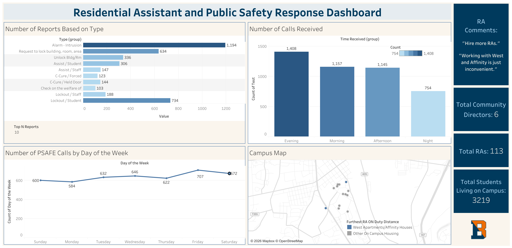

# Residential Assistant and Public Safety Response Time Dashboard

An interactive Tableau dashboard analyzing response times for Residential Assistants (RAs) and Public Safety (PSAFE) crisis calls at Bucknell University.

[View the interactive dashboard on Tableau Public](https://public.tableau.com/app/profile/maisie.mcgowan/viz/BucknellUniversityRAandPSafeResponseDashboard/TestDashboard)

## Objective
This project examines how Bucknell's Residential Education and Public Safety offices can reduce response times to campus crisis calls, and where improvements would have the greatest impact.

## Data
Years: 2023 - 2025

| Dataset | Source | Key Fields | Used For |
|---|---|---|---|
| **PSAFE Data** | Bucknell Public Safety | Incident type, date, time received, time dispatched, time arrived, time cleared, day of week | Calculating Public Safety response times by incident type and day |
| **RA On Call Logistics** | Bucknell Residential Education | Building, number of RAs, notes, staff, class year | Mapping RA coverage across four duty areas (RTKG, West-Affinity, McDonnell-Legacy, Swartz-South Campus) |
| **RA Response Times and Feedback** | Survey of 21 RAs | Comfort handling on-duty responsibilities (1-5 scale), RA residence, buildings served, open-ended comments | Mapping the distance RAs cover on duty and capturing qualitative feedback |
| **2023 Incident Log by Type** | Bucknell University | Incident, location, date reported, municipality, current status | Identifying where major housing-related incidents occur and placing them on the campus map |

**Privacy note:** RA survey responses were anonymized. No individual student information is included.

## Approach
Excel and Tableau analysis

## Key Findings
- Students experience significant delays in crisis response due to high call volume and unclear division of responsibilities between RAs and PSAFE.
- Overlap and confusion between PSAFE and RA duties cause inefficiencies, inconsistent responses, and added pressure on RAs.
- Current Residential Education scheduling leaves too few RAs covering too many students and buildings, leading to burnout and frustration among RA staff.

## Recommendations
- Hire an additional Community Director to oversee a new group of RAs
- Establish clearer boundaries of responsibilities between Public Safety and Residential Education staff 

## Files
- `Bucknell University RA and PSafe Response Dashboard.twbx`: Tableau workbook
- `dashboard_preview.png`: dashboard screenshot

## Credits
Original workbook by Maisie McGowan. Data from Bucknell University.
